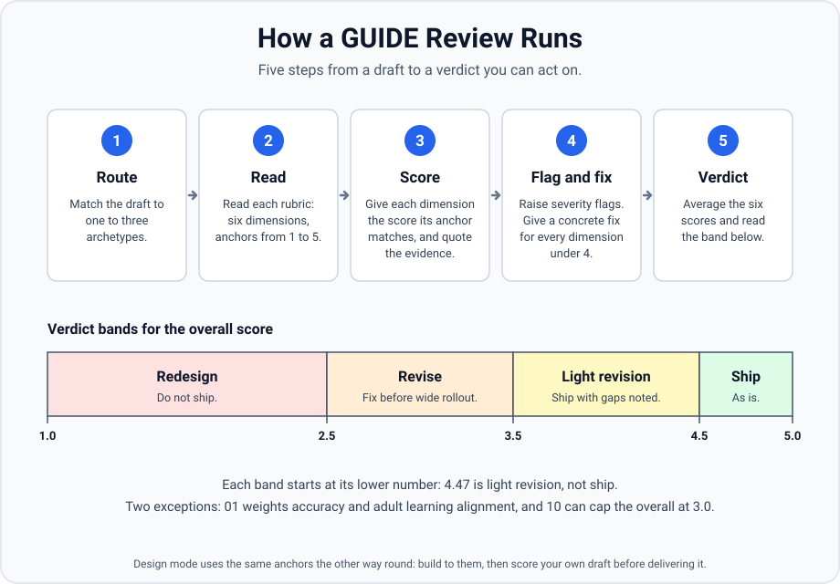
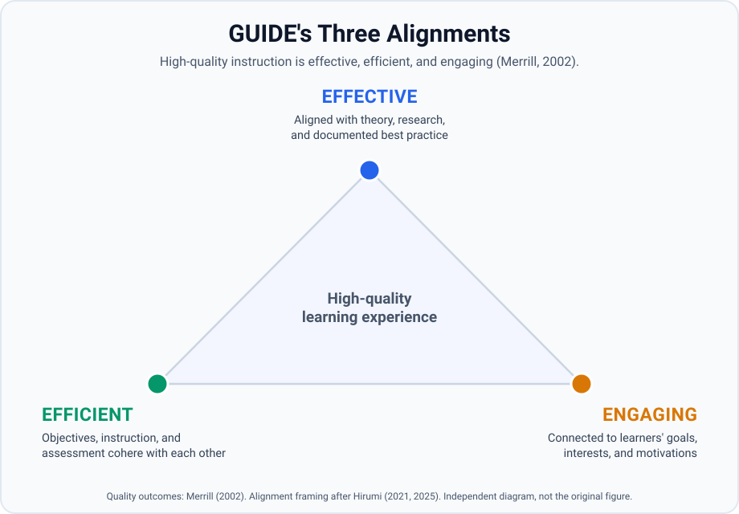
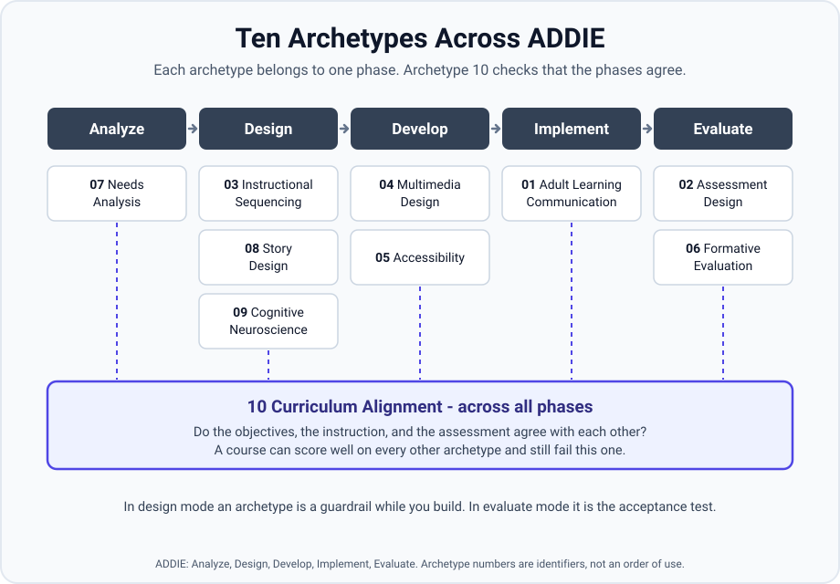
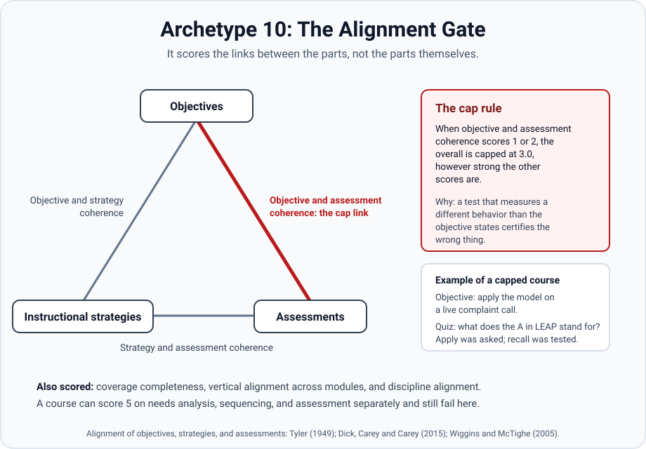

<div align="center">

<picture>
  <source media="(prefers-color-scheme: dark)" srcset="docs/art/hero-dark.png">
  
</picture>

**Design and grade instruction aligned to learning science.**

[](https://github.com/jermn007/GUIDE/releases/latest)
[](LICENSE)
[](#how-it-works)

[](#ten-archetypes-across-addie)
[](skill/guide-instructional-design/references/00_archetype_index.md#the-60-dimensions-at-a-glance)
[](skill/guide-instructional-design-plugin/PIPELINE.md)
[](#install)
[](https://doi.org/10.5281/zenodo.22949871)

[Install](#install) · [Quick start](#quick-start) · [How it works](#how-it-works) · [Status](STATUS.md) · [Changelog](CHANGELOG.md) · [Cite](#license-and-citation)

</div>

**Latest:** [v3.5.0](https://github.com/jermn007/GUIDE/releases/tag/v3.5.0) (November 13, 2026) adds three plugin commands (`/evaluate`, `/build`, `/pipeline`), slims the rubrics the skill loads by about a fifth, and tightens the assessment rubric for single items, test type, and answer keys.

## What GUIDE is

GUIDE (Grounded Universal Instructional Design Evaluator) is a set of rubrics that score instructional content (a lesson plan, a quiz, an e-learning module, a needs analysis) against published learning-science research. You can use it to **evaluate** something that already exists, or to **design** something new that meets the same criteria from the start. It runs inside Claude, so you ask for a review in plain language and get back a scorecard with reasons and next steps.

GUIDE started as the capstone synthesis for the University of Central Florida Master of Arts in Instructional Systems program.

## Install

GUIDE is listed in Anthropic's [Claude directory](https://claude.ai/directory), and that is the easiest way to install it. It works in the Claude apps, Cowork, and Claude Code, and directory installs receive new versions.

**From the Claude directory (recommended)**

Open [GUIDE Instructional Design in Claude](https://claude.ai/customize/plugins/id/d36ea61b-91f2-4262-b7ca-15a1984d1ec1%40anthropic-plugin-directory?via=directory) and select **Add**. You need to be signed in.

Or find it yourself:

1. In Claude, open **Settings**, then **Customize**. In the desktop app, choose **Plugins** under *Customize*.
2. Search for **GUIDE Instructional Design**.
3. Open it (it is marked "from Anthropic Directory") and select **Add**.

To get a newer version later, open the same page and select **Update**.

A new release reaches the directory after Anthropic reviews it, so the directory can be a version behind this repository for a few days.

**From this repository's marketplace**

Use this if you want each release the day it is published, or if the directory is not available to you.

In the Claude desktop app:

1. Open **Settings**, then **Plugins** (under *Customize* in the sidebar).
2. Select **Add**, then **Add marketplace**, then **Add from a repository**.
3. Enter `jermn007/GUIDE`.
4. When **Guide instructional design** appears in the list, select **Install**.

With slash commands:

1. Add the marketplace:

   ```
   /plugin marketplace add jermn007/GUIDE
   ```

2. Install the plugin:

   ```
   /plugin install guide-instructional-design@guide
   ```

> [!IMPORTANT]
> An added marketplace serves from a local copy, so reinstalling keeps the old version. To update, refresh the marketplace first, then update the plugin:
>
> ```
> /plugin marketplace update guide
> /plugin update guide-instructional-design@guide
> ```

**Other ways to install**

- **Plugin file (fixed snapshot, no updates):** download `guide-instructional-design.plugin` from the [latest release](https://github.com/jermn007/GUIDE/releases/latest), then run `/plugin install ./guide-instructional-design.plugin`.
- **Skill only:** download `guide-instructional-design.skill` from the same release. See [`skill/README.md`](skill/README.md) for where to put it.
- **Walkthrough with screenshots:** [`Installing-GUIDE-in-Claude.pdf`](Installing-GUIDE-in-Claude.pdf).

## Quick start

Once the plugin is installed, GUIDE turns on by itself when you talk about courses, lessons, quizzes, training, or learners. You don't need a special command, though the plugin adds three: `/evaluate`, `/build`, and `/pipeline`.

Paste a draft and ask for a review:

```text
Review this quiz item with GUIDE.

Objective: Given a customer complaint, the agent will choose the
de-escalation response that follows the company's LEAP model.

Item: What does the "A" in LEAP stand for?
  a) Acknowledge   b) Apologize   c) Assist   d) Assess
```

GUIDE matches the item to **Assessment Design** (archetype 02) and returns:

- A score from 1 to 5 on each of its six dimensions, such as *Bloom's Alignment* and *Objective Congruence*, with the evidence behind each score.
- An overall score and a plain verdict: ship, light revision, revise, or redesign.
- Severity flags for serious problems.
- One to three concrete fixes.

This sample item has a classic flaw for GUIDE to catch: the objective asks learners to *apply* a model, but the item only asks them to *recall* it.

<p align="center">
  
</p>

**Learn to score by doing it.** [Practice: score this, then compare](docs/practice.md) has three five-minute exercises with GUIDE's scores and reasoning to check yours against, and a short review schedule for the week after.

To **design** instead of grade, ask for the thing you want built, for example: *"Write a three-item scenario quiz for that objective, using GUIDE."* GUIDE writes against the same dimensions and checks its own work before handing it over.

<details>
<summary><strong>Run a judge from Python</strong></summary>

Each archetype is also a standalone judge prompt you can call from Python. You need Python 3.10 or later and an Anthropic API key in `ANTHROPIC_API_KEY`.

```bash
git clone https://github.com/jermn007/GUIDE.git
cd GUIDE
pip install anthropic
python guide_registry.py   # lists the 10 registered archetypes
```

```python
from guide_registry import evaluate

result = evaluate(
    "assessment_design",
    input="Objective: Given a customer complaint, choose the de-escalation "
          "response that follows the LEAP model.",
    output='What does the "A" in LEAP stand for? '
           "a) Acknowledge b) Apologize c) Assist d) Assess",
)
print(result.overall_score)
print(result.scores)
print(result.improvement_suggestions)
```

For LangChain or LangSmith pipelines, install `langchain-anthropic langchain-core` (and `langsmith`) and use `make_evaluator()` or `run_langsmith_eval()` from [`guide_base.py`](guide_base.py).

</details>

## How it works

GUIDE uses the LLM-as-a-judge pattern (Zheng et al., 2023). Each **archetype** is a full rubric for one kind of instructional work. Each archetype scores **six dimensions**, and each dimension has a 1 to 5 scale with a written description of what each score looks like. The same rubric drives both modes: in evaluate mode it grades, and in design mode it is the spec.

### Three quality outcomes

Good instruction is effective, efficient, and engaging (Merrill, 2002). Hirumi (2025), building on Hirumi, Ratliff and de la Mora (2021), links each outcome to an alignment of instructional elements. GUIDE checks all three.

<p align="center">
  
</p>

- **Effective:** the design follows theory, research, and documented best practice (Hannafin, Hannafin, Land and Oliver, 1997). This is the *grounded* in GUIDE.
- **Efficient:** objectives, instructional strategies, and assessments agree with each other (Tyler, 1949; Bloom, 1956; Dick, Carey and Carey, 2015), so learners don't do wasted work.
- **Engaging:** the design connects to learners' personal and professional goals and motivations (Keller's ARCS model, 1987 and 2010).

### Ten archetypes across ADDIE

Each archetype maps to a phase of the ADDIE lifecycle. Archetype 10 checks that the pieces fit together, so a course can score well on every other archetype and still fail it.

<p align="center">
  
</p>

| # | Archetype | Use it for | ADDIE phase | Grounded in |
|---|-----------|-----------|-------------|-------------|
| 07 | Needs Analysis | training requests, performance gaps, objectives | Analyze | Van Tiem, Kaufman, Mager, Keller |
| 03 | Instructional Sequencing | lesson plans, course outlines, learning paths | Design | Gagne, Merrill, Keller, Vygotsky |
| 08 | Story Design | scenarios, case studies, branching, role-play | Design | Campbell, Snyder, the Story Circle |
| 09 | Cognitive Neuroscience | memory, attention, emotion, the 5E model | Design | Bybee (5E), Ausubel, Brown, Posner and Rothbart |
| 04 | Multimedia Design | e-learning, video, slides, interactive media | Develop | Mayer, Clark, Sweller |
| 05 | Accessibility | web and LMS content, digital materials | Develop | WCAG 2.1, CAST UDL, Nielsen |
| 01 | Adult Learning Communication | chatbot and help answers for learning professionals | Implement | Knowles, Mezirow, Sweller, Ausubel |
| 02 | Assessment Design | quizzes, tests, item banks, rubrics | Evaluate | Anderson and Krathwohl, Mager, Kubiszyn and Borich |
| 06 | Formative Evaluation | evaluation plans, usability tests, pilots | Evaluate | Bordonaro, Dick and Carey, Nielsen |
| 10 | Curriculum Alignment | do objectives, instruction, and assessment agree? | Across all phases | Tyler, Anderson and Krathwohl, Webb, Mager, Dick and Carey, Wiggins and McTighe, Reigeluth, Hirumi |

Archetype 10 scores the links between the parts, and one link carries a cap:

<p align="center">
  
</p>

### Sources

Every name in the table above is cited in that archetype's rubric. Full citations are in each archetype's rubric in [`archetypes/`](archetypes) (the `handoff_*.md` files) and in the matching archetype section of [`GUIDE_Rubric_Document.docx`](GUIDE_Rubric_Document.docx), the printable version of the whole framework. [`archetypes/discipline_alignment_crosswalk.md`](archetypes/discipline_alignment_crosswalk.md) maps each archetype to the IBSTPI, ATD, and ISPI professional standards. That mapping is the author's own and is not endorsed by those organizations.

<details>
<summary><strong>The 13-agent ADDIE pipeline</strong></summary>

The plugin includes 13 agents that build instructional content from start to finish: a router, the 10 archetype specialists (the Curriculum Alignment specialist doubles as the acceptance gate), a synthesizer, and a reviser. Each archetype acts first as a design guardrail and then as an acceptance test. See [`PIPELINE.md`](skill/guide-instructional-design-plugin/PIPELINE.md) for phase order, severity flags, and score thresholds.

For batch evaluation, [`guide_pipeline.py`](guide_pipeline.py) runs the same pipeline from Python as `ADDIEPipeline`, and [`smoke_test_pipeline.py`](smoke_test_pipeline.py) is its mocked end-to-end test:

```bash
python smoke_test_pipeline.py
```

</details>

<details>
<summary><strong>Self-evaluation history</strong></summary>

GUIDE is scored against its own rubrics at most releases. Six archetypes apply to GUIDE itself (01, 02, 03, 04, 05, 09). Archetypes 06, 07, and 08 score artifact types GUIDE is not, so they are marked N/A. Archetype 10 applies from v3.1.0.

| Version | Composite, 6 archetypes | With archetype 10 | Report |
|---|---|---|---|
| v2.2.0 | 3.4 / 5 | N/A | [Baseline](self-evaluations/GUIDE_Self_Evaluation.md) |
| v3.0.0 | 4.0 / 5 | N/A | [v3.0.0](self-evaluations/GUIDE_Self_Evaluation_v3.0.0.md) |
| v3.1.1 | 4.3 / 5 | 4.2 / 5 | [v3.1.1](self-evaluations/GUIDE_Self_Evaluation_v3.1.1.md) |
| v3.2.3 | 4.3 / 5 | 4.2 / 5 | [v3.2.3](self-evaluations/GUIDE_Self_Evaluation_v3.2.3.md) |
| v3.3.0 | 4.3 / 5 | 4.3 / 5 | [v3.3.0](self-evaluations/GUIDE_Self_Evaluation_v3.3.0.md) |
| v3.4.0 | 4.4 / 5 | 4.3 / 5 | [v3.4.0](self-evaluations/GUIDE_Self_Evaluation_v3.4.0.md) |
| v3.5.0 | 4.4 / 5 | 4.4 / 5 | [v3.5.0](self-evaluations/GUIDE_Self_Evaluation_v3.5.0.md) |

Highlights:

- **v3.1.1** applied archetype 10 to GUIDE for the first time. It scored 2 on Discipline Alignment because GUIDE did not map to a professional competency framework.
- **v3.3.0** added the discipline crosswalk and raised that score from 2 to 4. It stops at 4 because a self-published crosswalk is not accreditation.
- **v3.4.0** brought the printable rubric back to parity and added the first diagram, which raised Multimedia Principle Compliance from 3 to 4.
- **v3.5.0** scored the living framework and the printable rubric together, re-reading every dimension against its anchor, and came out at 4.4 on the six archetypes (4.42) and 4.4 with archetype 10 (4.36, just over the rounding line), the same headline as v3.4.0. The earlier figure reads about 4.2 under the same strict scoring, so this release is a gain: practice exercises, a spaced review schedule, three new diagrams, a screen-reader pass, a reason-to-care scenario for each archetype, and live runs of the edge cases on two models and of the full pipeline earned back eight points. Some of that evidence is thin (one screen reader, one run per case per model), and the report says where.

v3.2.2 was packaging only, and v3.4.1 fixed only the Python output format for three archetypes, so neither was re-scored.

</details>

<details>
<summary><strong>Repository structure</strong></summary>

```
GUIDE/
├── .claude-plugin/
│   └── marketplace.json                   # Plugin marketplace manifest
├── archetypes/
│   ├── archetype_XX_*.py                  # Judge prompt modules (01-10)
│   ├── discipline_alignment_crosswalk.md  # Archetype to IBSTPI / ATD / ISPI-HPT mapping
│   ├── edge_cases_XX.json                 # Labeled test cases (one file per archetype)
│   └── handoff_XX_*.md                    # Rubrics: the single source of truth
├── assets/
│   ├── *.svg                              # Diagrams used in this README (three alignments, ADDIE map, review flow, alignment cap)
│   └── *.png                              # The same diagrams, rasterized for the docx by docs/art/render_diagrams.py
├── docs/
│   ├── art/                               # README hero (hero.html) and plugin icon (icon.py) sources, rendered PNGs
│   ├── build_rubric_docx.py               # Regenerates the printable rubric's archetype sections from archetypes/
│   └── practice.md                        # Three score-then-compare exercises and a spaced review schedule
├── self-evaluations/                      # One self-evaluation per scored release
├── skill/
│   ├── guide-instructional-design/        # Canonical skill source
│   ├── guide-instructional-design-plugin/ # Installable plugin (skill mirror, 3 commands, 13 agents, PIPELINE.md, README.md)
│   ├── README.md                          # Skill and plugin install, build, and sync
│   └── build_skill.py                     # Regenerates skill references and plugin mirror from archetypes/
├── CHANGELOG.md                           # Release history
├── CITATION.cff                           # Citation metadata (Cite this repository)
├── GUIDE_Rubric_Document.docx             # Printable rubric (v3.5.0); archetype sections are generated
├── Installing-GUIDE-in-Claude.pdf         # Install guide with screenshots
├── LICENSE                                # Apache License 2.0
├── NOTICE                                 # Copyright and attribution
├── PRIVACY.md                             # Privacy policy (the plugin collects and sends nothing)
├── README.md                              # This file
├── STATUS.md                              # What works, what is open, what is next
├── run_edge_cases.py                      # Checks the edge-case files; --live scores them with a judge
├── guide_base.py                          # Result types, registry, evaluation runners
├── guide_pipeline.py                      # ADDIE multi-archetype orchestrator
├── guide_registry.py                      # Public Python API
├── smoke_test_pipeline.py                 # Mocked end-to-end pipeline test
└── test_judge_schemas.py                  # Checks every archetype asks for the standard output format
```

</details>

<details>
<summary><strong>Contributing</strong></summary>

- The rubrics live in `archetypes/handoff_*.md`. Edit those, then run `python skill/build_skill.py` to regenerate the skill references and the plugin mirror. Don't edit the mirror by hand.
- The plugin version in `skill/guide-instructional-design-plugin/.claude-plugin/plugin.json` is the version that marketplace installs see.
- Update [`CHANGELOG.md`](CHANGELOG.md) and [`STATUS.md`](STATUS.md) in the same commit as the change they describe.
- Before a pull request, run `python guide_registry.py`, `python test_judge_schemas.py`, and `python smoke_test_pipeline.py`.

</details>

## License and citation

GUIDE is licensed under the [Apache License 2.0](LICENSE). Copyright 2026 Jeremy Terhune. See [`NOTICE`](NOTICE) for attribution.

If you use GUIDE in research, teaching, or training, select **Cite this repository** in the sidebar on GitHub for APA and BibTeX formats (the details come from [`CITATION.cff`](CITATION.cff)). In APA style:

> Terhune, J. (2026). *GUIDE: Grounded Universal Instructional Design Evaluator* (Version 3.5.0) [Computer software]. Zenodo. https://doi.org/10.5281/zenodo.22949871

That DOI covers all versions and always points to the latest release. To cite the exact version you used, take its DOI from the [Zenodo record](https://doi.org/10.5281/zenodo.22949871).
